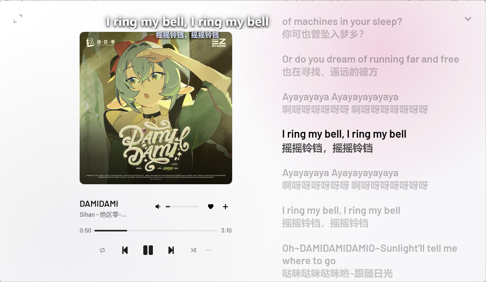
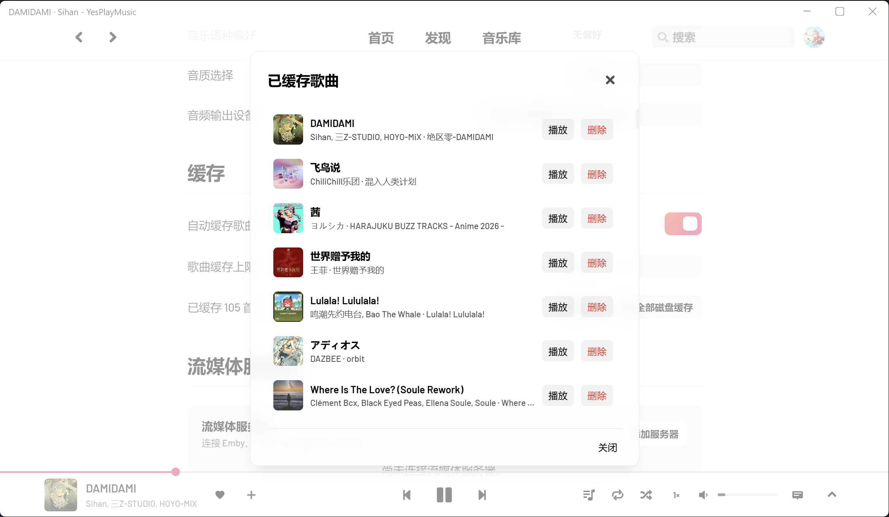
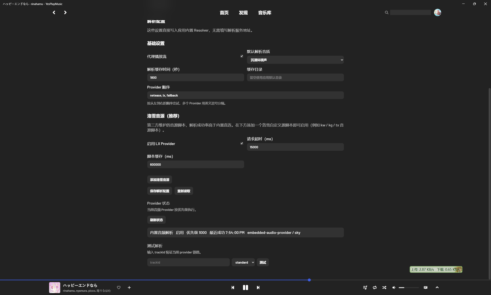
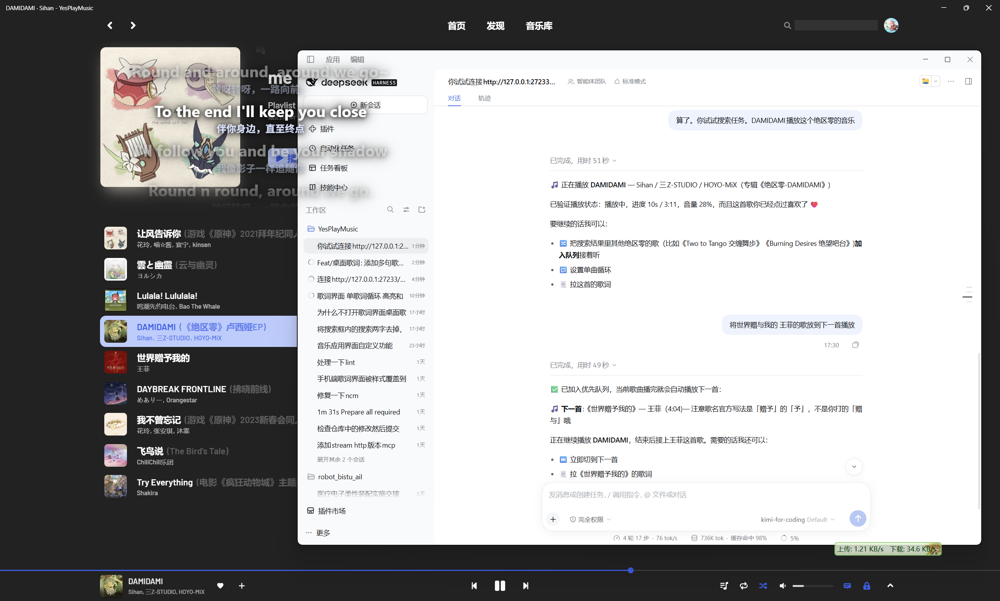
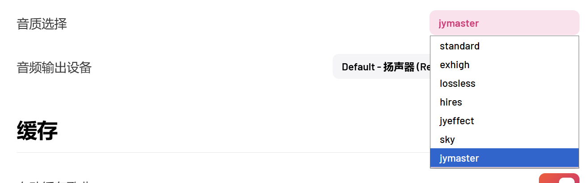
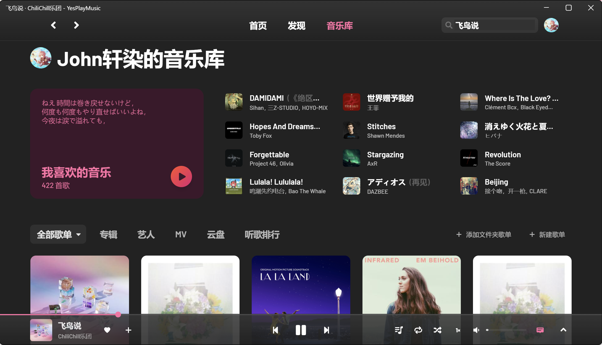

<p align="center">
  
</p>

<h1 align="center">XuMP</h1>

<p align="center">
  基于 YesPlayMusic 持续维护的现代跨平台音乐播放器
  <br>
  集成网易云音乐、本地音乐、流媒体服务器与可扩展音频解析
</p>

<p align="center">
  <a href="https://github.com/axuanran/YesPlayMusic/releases/latest"></a>
  <a href="https://github.com/axuanran/YesPlayMusic/actions/workflows/build.yaml"></a>
  <a href="https://github.com/axuanran/YesPlayMusic/stargazers"></a>
  <a href="LICENSE"></a>
</p>

<p align="center">
  <a href="https://github.com/axuanran/YesPlayMusic/releases/latest"><strong>下载客户端</strong></a>
  ·
  <a href="https://github.com/axuanran/YesPlayMusic/wiki"><strong>项目 Wiki</strong></a>
  ·
  <a href="https://github.com/axuanran/YesPlayMusic/issues"><strong>问题反馈</strong></a>
  ·
  <a href="https://t.me/ypmaxuanran"><strong>Telegram 频道</strong></a>
</p>

## 请使用标注为Latest的版本
## 最近新增

- 📻 **私人漫游**：在首页或音乐库原有的私人 FM 卡片中选择默认、熟悉、探索或场景模式，场景包含运动、专注、助眠、通勤等；选择会保存在当前设备。支持通过 [`music_roaming` MCP 工具](llm-docs/mcp.md#personal-roaming)查看状态、启动、切换模式和场景、下一首及不喜欢。正在漫游时切换模式会更新推荐歌曲，切换失败保留原模式。自定义网易云 API 服务需支持 [`/personal/fm/mode`](https://neteasecloudmusicapienhanced.js.org/#/?id=私人-fm-模式选择)。  感谢 @xzl01
- 🤖 **内置 MCP 服务器**：AI 助手可直接搜索、播放、管理播放队列与歌词，支持 Streamable HTTP 与本地控制通道
- 🎤 **桌面歌词多行模式**：同时显示前后文并高亮当前行，第一句和最后一句也能滚动到窗口正中
- 🖱️ **桌面歌词交互可配置**：滚轮行为（调整进度 / 滚动歌词）与拖动行为（选择歌词 / 整个窗口拖动）都可按习惯选择
- 🔁 **单句循环**：歌词页与桌面歌词窗口都能锁定当前句反复播放（快捷键 Alt+E）
- 🪟 **虚拟桌面固定（Windows）**：桌面歌词窗口可固定到所有虚拟桌面并保持相同位置
- 🧩 **界面布局自定义**：功能卡片独立化，首页模块可自由编排
- 🛠️ **队列页面重做**：本地化标题、分区语义化，完善加载 / 空列表 / 部分失败重试状态
- 🔍 **导航搜索优化**：修复全局样式对搜索框背景的干扰
- 🙏 **感谢所有贡献者**：代码、文档、翻译、测试与问题反馈都是贡献，完整名单见[贡献者](#贡献者)

---

此项目基本接受所有的AI PR。允许各位直接在dev分支直接进行测试和修复。随时可提交fix。也没几个人来开发，所以随意。看到有pr会合并。

dev分支不再随推送自动编译到Release，只在手动运行 Release 工作流或打 v* 标签时构建 prerelease。被合并后可以安装查看自己编写的内容是否完善。如果本地没有编译环境也可以通过积极的fix提交pr。

也因此dev版本（即pre-release）没有任何测试保证。普通使用建议下载标注为latest的版本。

如何提交pr：先fork然后clone下来后拿ai实现下后提交到你自己的仓库然后提交pr。最后将pr从草稿改为准备好审核

### Windows平台建议下载标注为latest的版本的 XuMP Setup xxx.exe

目前发布前测试可能会仅处理 Windows Setup包，如果其他平台有问题需要issue处理（抱歉）

---

求star ~

此 README 以及本项目的修改部分基本由 AI 编写

 https://github.com/axuanran/YesPlayMusic/releases/tag/%232474 ，此版本仅对上游升级了api-enhance版本

## 项目简介

**XuMP** 是基于 [YesPlayMusic](https://github.com/qier222/YesPlayMusic) 的持续维护分支。项目保留原版清爽的网易云音乐体验，并围绕现代前端架构、桌面系统集成、Android、本地媒体库和音频可用性持续演进。

当前前端基于 Vue 3 与 Vite，桌面端基于 Electron 和 `electron-vite`，手机端基于 Capacitor / Android Media3，同时提供 Web、Docker 与终端界面。Windows 和 Linux 是主要测试平台；macOS、Android 及部分 ARM 构建由 CI 提供，实际兼容性可能因系统环境而异。

> 本项目是非官方第三方客户端，与网易云音乐官方无关。部分在线能力和第三方音源会受到账号权限、网络环境及上游接口变化影响。

## 界面预览

<p align="center">
  
</p>

<p align="center"><sub>沉浸式播放与多行歌词</sub></p>

<table>
  <tr>
    <td width="50%"></td>
    <td width="50%"></td>
  </tr>
  <tr>
    <td align="center"><sub>缓存浏览与离线播放</sub></td>
    <td align="center"><sub>音频 Resolver 状态与 Provider 管理</sub></td>
  </tr>
</table>

<p align="center">
  
</p>

<p align="center"><sub>内置 MCP 服务器：AI 助手直接搜索、播放并管理播放队列</sub></p>

<details>
<summary>查看更多界面截图</summary>

<br>






</details>

## 核心能力

| 模块 | 能力概览 |
| --- | --- |
| 网易云音乐 | Cookie 与网页登录、每日推荐、私人漫游（默认 / 熟悉 / 探索 / 场景）、云盘、MV、搜索、收藏和歌单管理 |
| 音频解析 | Netease、LX（洛雪）、Fallback Provider；音质选择、灰色歌曲替换、缓存与管理面板 |
| Android | Capacitor 原生壳、Media3 后台播放、MediaSession、原生缓存、锁屏与通知栏控制 |
| 本地音乐 | 文件夹扫描、元数据与封面读取、本地歌词匹配、文件夹歌单及统一播放队列 |
| 流媒体 | 连接 Emby、Jellyfin 等兼容服务器，浏览并播放专辑、歌手和歌曲 |
| 歌词体验 | 滚动歌词、翻译与发音歌词、独立桌面歌词、AMLL WebSocket 同步 |
| 桌面集成 | Windows SMTC、Linux MPRIS、Discord Rich Presence、系统托盘、全局快捷键与自动更新 |
| 播放体验 | 音质与输出设备选择、播放速度、缓存播放、媒体按键、深浅色主题与低性能模式 |
| AI 控制 | 内置 MCP 服务器与本地控制接口，支持搜索、播放、队列、歌词与私人漫游；详见 [MCP 文档](llm-docs/mcp.md) 与[控制 API 文档](docs/control-api.md) |
| 其他形态 | Web / PWA、Docker 自托管、基于 mpv 的 TUI |

音频 Resolver 采用 Provider 链管理不同来源，可查看解析状态、测试歌曲、调整 Provider 顺序并管理缓存。第三方 Provider 的可用性不作长期保证。

## 相比上游的新增功能

分叉点为 `df075cc`（`fix: Vue Router on Netlify (#2467)`）。此后上游只有 13 个提交并停在 0.4.11，本仓库同期累计 516 个提交。

| 模块 | 新增 / 变化内容 | 上游 qier222/YesPlayMusic | 主要贡献者 |
| --- | --- | --- | --- |
| 基础框架 | Vue 3.5 + Vite 7 + electron-vite，ESLint 9 flat config | Vue 2.6 + Webpack 4 | axuanran |
| 桌面运行时 | Electron 42，主进程 / preload / renderer 三段式，NSIS、Portable、AppImage、deb、rpm、snap、pacman | Electron 13 + vue-cli 插件链 | axuanran |
| Android 端 | Capacitor 壳、Media3 后台播放与锁屏控制、原生缓存（512MB LRU）、原生登录与反作弊 token、系统级下载 | 无 | axuanran |
| 终端 TUI | 基于 mpv 的终端界面，安装包不含，按需从 R2 下载 | 无 | axuanran |
| Docker | 单容器：nginx + 内置 API + Audio Resolver，含健康检查与数据卷 | 仅静态 Web 镜像 | axuanran |
| 音频 Resolver | 独立 `server/`：Provider 链、缓存、流代理、Cookie 同步、管理面板 | 无 | axuanran |
| 音质体系 | `standard` / `exhigh` / `lossless` / `hires` / `jyeffect` / `sky` / `jymaster` 七档，支持逐级降级 | 固定 128k / 320k / 无损 | axuanran |
| 本地音乐 | 文件夹扫描、元数据与封面读取、本地歌词匹配、文件夹歌单 | 无 | axuanran |
| 流媒体服务器 | Emby / Jellyfin 多服务器连接、浏览与播放 | 无 | axuanran |
| 播客 | `/podcast` 列表与详情 | 无 | axuanran |
| 私人漫游 | 默认 / 熟悉 / 探索 / 场景模式，设备内持久化，配套 `music_roaming` MCP 工具 | 仅单一私人 FM | **xzl01** |
| 播放内核 | 移除 howler，自研 AudioEngine + xstate 状态机 + Provider 解析链 | howler | axuanran |
| 队列与播放交互 | 队列弹层、播放模式菜单、播放速度、大列表增量渲染 | 基础队列 | **babaele**、axuanran |
| 缓存与下载 | 缓存浏览与按曲目管理、缓存位置可更改（用 junction / symlink 迁移缓存目录，登录与设置不动）、桌面端与 Android 下载 | 仅基础缓存 | axuanran |
| 桌面歌词 | 独立歌词窗口、多行模式、位置与溢出处理、样式模板、单句循环 | 无 | axuanran |
| 歌词同步 | AMLL WebSocket 同步、歌词时钟、歌词显示模式 | 无 | axuanran |
| 系统媒体集成 | Windows SMTC、虚拟桌面固定、托盘图标主题、窗口外观与低性能模式 | 无 | axuanran |
| Linux 集成 | MPRIS 重写与登录稳定性改进 | 基础 MPRIS | **LEILU-lua** |
| macOS Touch Bar | 播放控制按钮 | 无 | **babaele** |
| MCP / 控制接口 | 内置 MCP 服务器（Streamable HTTP）、本地控制通道、`xumpctl`、独立 mcp-http | 无 | **xzl01**、axuanran |
| 插件系统 | manifest / runtime / routes / settings / events / audio provider 注册 | 无 | axuanran |
| 工程质量 | Vitest（90 个测试文件）、七个 GitHub Actions 工作流 | 无测试体系 | axuanran |
| 已移除 | UnblockNeteaseMusic Provider，改用 LX（洛雪） | 有 UNM 开关 | axuanran |

> 「主要贡献者」列只标注社区 PR 来源，其余为本项目维护者。`babaele` 的 NCM 投屏 PR（#37）已回滚，仅保留 Touch Bar 与队列 / 播放交互。完整名单见[贡献者](#贡献者)。

## 平台与分发

| 平台 | 可用形式 | 说明 |
| --- | --- | --- |
| Windows x64 | NSIS 安装包、Portable | 主要测试平台 |
| Linux x64 | AppImage、deb、rpm、tar.gz、snap、pacman | 主要测试平台 |
| Linux ARM | deb、tar.gz | CI 构建支持 |
| Android | APK | 应用名 XuMP，包名 `com.axuanran.xump` |
| Arch Linux | [AUR：yesplaymusic-axuanran-bin](https://aur.archlinux.org/packages/yesplaymusic-axuanran-bin) | 现有 AUR 包，安装后的程序名为 XuMP |
| Gentoo | `media-sound/yesplaymusic-bin` | 通过 xr-overlay 安装，程序命令为 `xump` |
| macOS | Intel 与 Apple Silicon dmg | CI 构建，测试覆盖有限 |
| Docker | Compose、GHCR 镜像 | 镜像为 `ghcr.io/axuanran/xump`，当前仍属测试阶段 |
| Web / PWA | Vite Web 应用 | 支持 |

## 安装

### 桌面客户端

请从 [Releases](https://github.com/axuanran/YesPlayMusic/releases/latest) 下载适用于当前系统的安装包。普通用户建议选择标记为 **Latest** 的正式版本；prerelease 包含较新的改动，更适合测试与反馈。

- Windows：优先选择 XuMP 的 NSIS 安装包，免安装可使用 `XuMP.exe`。
- Linux：按发行版选择 AppImage、deb、rpm、tar.gz、snap 或 pacman 包；主程序命令为 `xump`。
- macOS：根据设备选择 x64 或 ARM64 dmg；当前构建可能需要自行处理系统签名提示。
- Android：安装 `XuMP-android-<version>.apk`。

AppImage 首次运行前需要添加执行权限：

```bash
chmod +x XuMP-*.AppImage
./XuMP-*.AppImage
```

### 命令行（xump）

桌面客户端的主程序命令为 `xump`（Windows 下为 `XuMP.exe`，因文件名不区分大小写，直接在终端输入 `xump` 即可）。各端加入 PATH 的方式：

- Windows：NSIS 安装包在安装时勾选 **Add XuMP to PATH**（默认勾选，写入系统 PATH；应用自动更新会保留你的选择）。免安装版请自行将所在目录加入 PATH。
- Linux：deb、rpm、snap、pacman 包安装后自带 `/usr/bin/xump`，可直接使用；AppImage 与 tar.gz 可将可执行文件链接进 `~/.local/bin`：

  ```bash
  mkdir -p ~/.local/bin
  ln -s "$PWD/XuMP-0.1.6.AppImage" ~/.local/bin/xump
  ```

  tar.gz 解压目录内附带 `scripts/install-cli.sh`，也可直接运行 `./scripts/install-cli.sh install`（卸载用 `uninstall`）。
- macOS：app 内附带安装脚本，运行一次即可创建 `/usr/local/bin/xump` 链接：

  ```bash
  sudo /Applications/XuMP.app/Contents/Resources/scripts/install-cli.sh install
  ```

终端控制（`xumpctl`）与独立 TUI（`xump-tui`）见下文「TUI」，控制接口细节见[控制 API 文档](docs/control-api.md)。

### Arch Linux

```bash
yay -S yesplaymusic-axuanran-bin
```

也可以将 `yay` 替换为其他 AUR Helper，例如 `paru`。安装后的主程序命令为 `xump`。

### Gentoo

```bash
sudo eselect repository add xr-overlay git https://github.com/axuanran/xr-overlay.git
sudo emaint sync -r xr-overlay
```

该软件包当前使用测试关键字。amd64 用户可执行：

```bash
sudo mkdir -p /etc/portage/package.accept_keywords
echo "media-sound/yesplaymusic-bin ~amd64" | \
  sudo tee /etc/portage/package.accept_keywords/yesplaymusic
sudo emerge -av media-sound/yesplaymusic-bin
```

arm64 用户请将 `~amd64` 替换为 `~arm64`。维护和发布说明见 [Gentoo 打包文档](docs/gentoo-package.md)。

## Docker 部署

> Docker 支持目前仍属测试阶段，不保证可用。镜像构建已不再随 `dev` 自动触发，仅在 `v*` 标签推送或手动运行 Docker 工作流时产出，`latest` 可能落后于源码。

镜像是单容器结构：容器内由 nginx 提供前端静态页面并反向代理，同时运行内置网易云音乐 API 与 Audio Resolver（含 `/admin/` 管理面板）。旧版本依赖的独立 UnblockNeteaseMusic 旁路服务已移除，音源解锁改由内置 LX（洛雪）Provider 负责。

### 使用 Docker Compose（推荐）

```bash
git clone --branch dev https://github.com/axuanran/YesPlayMusic.git XuMP
cd XuMP
docker compose pull
docker compose up -d
```

启动后访问 `http://localhost`（默认映射宿主机 80 端口），音源解析管理面板位于 `http://localhost/admin/`。运行数据与 Resolver 配置保存在 `xump-data` 数据卷中，容器自带 `/api/health` 健康检查。

常用维护命令：

| 命令 | 用途 |
| --- | --- |
| `docker compose ps` | 查看容器与服务状态 |
| `docker compose logs -f` | 跟踪日志 |
| `docker compose pull && docker compose up -d` | 拉取新镜像并重建 |
| `docker compose down` | 停止并移除容器 |

Compose 文件支持的环境变量：

| 变量 | 默认值 | 说明 |
| --- | --- | --- |
| `XUMP_IMAGE` | `ghcr.io/axuanran/xump:latest` | 指定镜像与版本标签 |
| `TZ` | `Asia/Shanghai` | 容器时区 |

需要更换宿主机端口时，直接修改 `docker-compose.yml` 中的 `ports`（例如 `"8080:80"`）后重新执行 `docker compose up -d`。

### 镜像标签

| 标签 | 含义 |
| --- | --- |
| `latest` | 默认标签，来自 `dev` 分支构建；分支自动构建已关闭，可能落后于源码 |
| `dev` | `dev` 分支的构建产物 |
| `v0.1.6` | 与 Release 标签一一对应，GHCR 上已发布到 `v0.1.6` |
| `sha-<commit>` | 按提交构建 |

长期部署建议固定到 Release 标签，而不是使用 `latest`：

```bash
XUMP_IMAGE=ghcr.io/axuanran/xump:v0.1.6 docker compose up -d
```

### 使用 docker run

不使用 Compose 时可直接运行容器：

```bash
docker run -d \
  --name xump \
  --restart always \
  -p 80:80 \
  -v xump-data:/data \
  -e TZ=Asia/Shanghai \
  ghcr.io/axuanran/xump:latest
```

> 镜像标签与容器内部结构可能随 `dev` 变动，升级前请先用固定标签验证。版本变更记录见 [CHANGELOG](CHANGELOG.md)。

## TUI（暂缓推进）

项目提供基于 `mpv` 的终端界面，支持网易云登录与 Cookie 同步、搜索、私人 FM 和终端播放。

TUI 与 mpv 约 209 MB，**不再随安装包分发**，默认不下载。需要时在「设置 → TUI 与 mpv（可选下载）」下载即可，下载后可随时删除。细节见 [TUI 与 mpv 的可选下载](docs/tui-bundle.md)。

> TUI 目前暂缓推进，入口保留但随时可能调整。

```bash
yarn tui        # 从源码运行
xump --tui      # 从桌面程序启动
xump-tui        # 运行独立 TUI 入口
```

从源码运行时仍需自行安装 `mpv`；打包版会优先使用上面下载的 mpv。

<details>
<summary>查看 TUI 截图</summary>

<br>


</details>

## 开发指南

### 环境要求

- Node.js `>=22 <26`
- Yarn `1.22.22`
- Git
- 对应平台的 Electron 构建依赖

### 本地启动

```bash
git clone --branch dev --recursive https://github.com/axuanran/YesPlayMusic.git XuMP
cd XuMP
corepack enable
yarn install
```

复制环境变量文件：

```bash
cp .env.example .env
```

Windows PowerShell 请使用：

```powershell
Copy-Item .env.example .env
```

### 常用命令

| 命令 | 用途 |
| --- | --- |
| `yarn dev` | 启动 Web 开发环境 |
| `yarn desktop:dev` | 启动 Electron 开发环境 |
| `yarn tui` | 启动 TUI |
| `yarn lint` | 执行代码检查 |
| `yarn test` | 运行测试 |
| `yarn build` | 构建 Web 应用 |
| `yarn verify` | 依次执行 lint、test 与 build |

如果 Electron 二进制或原生依赖安装不完整，可运行 `yarn electron:repair-and-serve` 进行修复并重新启动。

### 桌面端构建

| 命令 | 产物 |
| --- | --- |
| `yarn desktop:build` | 当前平台桌面构建 |
| `yarn electron:build-win-dir` | Windows 未打包目录，适合快速验证 |
| `yarn electron:build-win-installer` | Windows NSIS 安装包 |
| `yarn electron:build-win-portable` | Windows Portable |
| `yarn electron:build-linux` | Linux 桌面包 |
| `yarn electron:build-mac` | macOS dmg |

Web 构建输出到 `dist`，桌面构建输出到 `dist_electron`。跨平台发布建议使用项目的 GitHub Actions 工作流。打包配置、体积构成与裁剪方式见 [打包与产物体积](docs/packaging.md)。

### Android 手机端（开发中，暂不可用）

手机端使用 Capacitor，共用现有 Vue 3 页面、账号、歌单与播放器逻辑。Android 应用显示名称为 **XuMP**，正式包标识为 `com.axuanran.xump`。无需配置公网网易云 API 或 Audio Resolver 地址：Android 原生模块直接完成网易云 `weapi/eapi` 加密、Cookie 管理和 HTTPS 请求；音频地址由 Vue 内置 Provider 解析，桌面端和 Android 共用。

```bash
yarn mobile:sync
yarn mobile:open
```

`mobile:sync` 会生成 Web 资源并同步到 `android` 工程；`mobile:open` 会用 Android Studio 打开工程。Android 工程使用 `compileSdk 36`、`targetSdk 36`、`minSdk 24`，请在 Android Studio 中安装对应 SDK。

当前手机端实际解码与播放使用 Android Media3：原生 `MediaSessionService` 负责后台播放、音频焦点、拔出耳机自动暂停、锁屏与通知栏媒体控件；Vue 播放器通过 Capacitor 插件同步进度、播放状态及上一首/下一首命令。Media3 原生缓存使用 512MB LRU 上限，播放服务与预下载器共享歌曲缓存键。上一首、当前和下一首组成的播放窗口会同步到原生队列，可在 WebView 或播放服务重建后恢复会话与持久化队列。

| 命令 | 用途 |
| --- | --- |
| `yarn mobile:build` | 构建手机端 Web 资源 |
| `yarn mobile:assets` | 重新生成 Android 图标资源 |
| `yarn mobile:sync` | 构建并同步 Android 工程 |
| `yarn mobile:open` | 在 Android Studio 中打开工程 |
| `yarn mobile:run` | 构建并运行到已连接的 Android 设备 |

内置音频解析可在「设置 → 插件 → 内置音频解析」中启停、查看 Provider 状态、清理缓存和测试歌曲。它不依赖独立的 `server/resolver` 进程。

## 技术架构

- 前端：Vue 3、Vue Router 4、Vuex 4、Vue I18n、Vite、Sass
- 桌面端：Electron、electron-vite、electron-builder、electron-updater
- Android：Capacitor、Android Media3、MediaSessionService
- 服务与媒体：Node.js、Express、NeteaseCloudMusicApi Enhanced、LX（洛雪）音源脚本、music-metadata、mpv
- 工程质量：Vitest、ESLint、Prettier、GitHub Actions

```text
XuMP
├── src/         前端、播放器、插件与 Electron 代码
├── android/     Android / Capacitor 原生工程
├── server/      Audio Resolver 与管理接口
├── admin/       Resolver 管理页面
├── scripts/     构建、发布、TUI 与 xumpctl 脚本
├── docs/        功能、控制接口与打包文档
├── llm-docs/    面向 AI 的功能说明与 MCP 文档
└── .github/     CI、发布及发行版配置
```

## 贡献指南

欢迎提交 Bug 修复、平台适配、音频 Provider、文档、翻译和自动化测试。Pull Request 请以 `dev` 为目标分支，并尽量说明改动目的、验证方式和受影响平台。

### 报告问题

提交问题前请先搜索已有 [Issues](https://github.com/axuanran/YesPlayMusic/issues)。新问题建议附上：

- XuMP 版本、操作系统及安装包类型
- 是否使用 Docker 或第三方媒体服务器
- 可复现的操作步骤
- 相关日志和必要截图

### 发布流程

`dev` 是主要开发分支，也是 PR 的目标分支。自动构建已关闭：CI 在 Pull Request 与手动触发时运行，Release 由手动运行 **Release** 工作流（`workflow_dispatch`，可选 draft / prerelease / release）触发，或由 **Prepare XuMP Release** 工作流创建 `v*` 标签后触发，届时会构建各平台产物并生成对应的 Release。

Docker 镜像同样只在 `v*` 标签推送或手动运行 **XuMP Docker Image** 工作流时构建并推送至 GHCR。Release、R2、Telegram、桌面端和 Android 的发行品牌统一使用 **XuMP**。

## 致谢与许可

XuMP 基于 [qier222/YesPlayMusic](https://github.com/qier222/YesPlayMusic) 持续维护，并使用或参考以下项目：

- [NeteaseCloudMusicApi Enhanced](https://github.com/neteasecloudmusicapienhanced/api-enhanced)
- [LX Music（洛雪音源）](https://github.com/lyswhut/lx-music-desktop)
- [nagi-studio/YesPlayMusic](https://github.com/nagi-studio/YesPlayMusic)

早期版本曾集成 [UnblockNeteaseMusic](https://github.com/UnblockNeteaseMusic/server)，该 Provider 已因上游长期失修而移除，在此一并致谢。

感谢原项目作者、所有贡献者，以及持续参与测试和反馈的用户。

项目基于 [MIT License](LICENSE) 开源。使用本项目时，请同时遵守相关平台、媒体服务器及第三方服务的服务条款和所在地区法律法规。

## 贡献者

感谢每一位为 XuMP 提交代码、完善文档与翻译、参与测试或反馈问题的朋友。以下社区贡献者在分叉之后仍持续投入，特此致谢：

- [xzl01](https://github.com/xzl01)：MCP 控制接口与 `xumpctl`（#36）、私人漫游与 `music_roaming` 工具（#47）
- [babaele](https://github.com/babaele)：播放加载与队列交互体验（#38）、macOS Touch Bar（#37）
- [LEILU-lua](https://github.com/LEILU-lua)：Linux MPRIS 与登录稳定性改进

**项目维护与原作**：[Xuanran](https://github.com/axuanran)（现任维护者）、[qier222](https://github.com/qier222)（YesPlayMusic 原作者）

下面名单覆盖上游继承历史与本仓库的全部提交者，按提交量排序，同一人的多个邮箱与昵称已合并；完整贡献记录见 [GitHub 贡献者页面](https://github.com/axuanran/YesPlayMusic/graphs/contributors)。

<details>
<summary>查看全部贡献者（81 人）</summary>

<br>

qier222、Xuanran、kunkka、pan93412、memorydream、Vidocq、Map1en_、njzy、Revincx、Changjian Gao、wenjie、Rick、TestGifts、Younglina、StarsEnd、BeADre、colawithsauce、是虹川飴、runnableAir、Kris Hu、marcus、Karbob、mayandev、郭桓桓、chen310、代强、xzl01、Mr. Will、babaele、Wenqi Huang、タイムライン、BakerBunker、拆家大主教、草方块、Ethan Wong、GalvinGao、Shi Liang、poly000、5unV、fengkx、LEILU-lua、12471220、Holger、Frz、amphineko、zuotiya、Davy、LittleChest、657、久治明千树汐、洩氏诹诹子、MUXTER117、CNawalol、Wei Jiahao、scarletborder、jbwfu、guaqiu、FSpark、火花✨、Felix_SANA、HengYi Wei、Arthals、Sin、李洋、moonrailgun、Jiang Menghao、bestlaw66、Chiro、Chuwen、leex、Viyerelu23333、akliuxingyuan、leko、Anmizi、Siykt、bluebullet、Vanilla、sr.zer、Kay W、CuSO4Deposit、人工知能

</details>

---

<p align="center">
  如果这个项目对你有帮助，欢迎 Star 或参与贡献。
</p>
